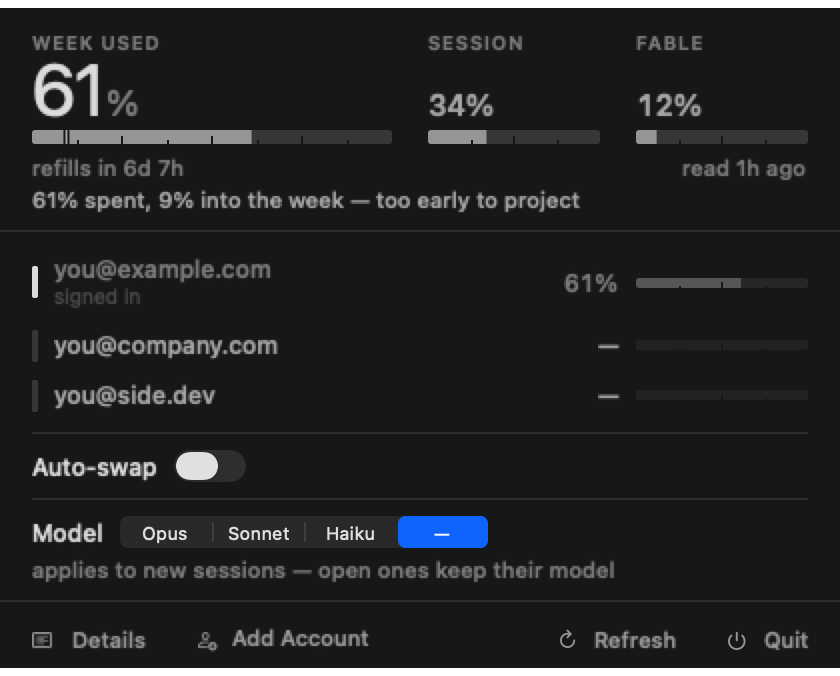
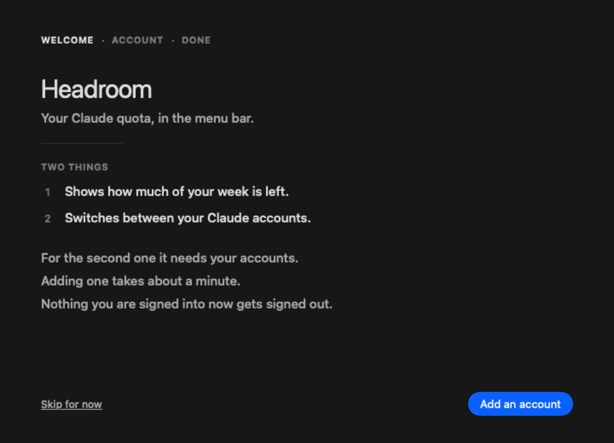
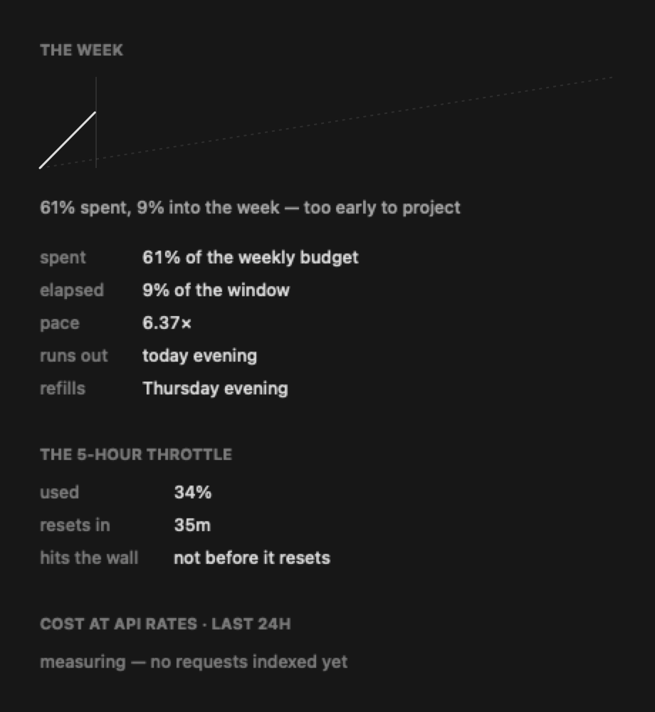

# Headroom

A macOS menu bar gauge for Claude Code quota that also swaps between Claude accounts.



Two tools already exist either side of this. SessionWatcher shows quota well but cannot
switch accounts. [caam](https://github.com/Dicklesworthstone/caam) switches accounts but
defers per-account usage. Headroom does both, and the piece that makes that possible is
asking Anthropic's own usage endpoint for *each* stored account — so "which account should
I move to" is answered with live numbers instead of a guess.

Swift, SwiftUI and AppKit. Zero third-party dependencies. macOS 14+.

## Install

Download the latest `.dmg` from [Releases](../../releases), drag Headroom to Applications,
and launch it. It walks you through adding your accounts on first run.



> The build is signed ad-hoc, not notarized — there is no Apple Developer identity behind
> it. macOS will refuse the first launch of a downloaded copy. Open **System Settings ▸
> Privacy & Security**, find the blocked Headroom entry near the bottom, and choose **Open
> Anyway**. That entry only appears *after* a refused launch. Building from source avoids
> this entirely.

Or build it:

```sh
git clone https://github.com/angusbuilds/headroom.git
cd headroom
./install.sh
```

Needs a Swift 6 toolchain. Xcode is not required — `build.sh` assembles the bundle by hand.

> **On multiple accounts.** Headroom swaps between Claude subscriptions *you own*. Rotating
> several subscriptions to extend your own limits is not something Anthropic's usage policy
> addresses directly, so form your own view before you lean on it. The quota gauge is useful
> on a single account and Headroom works fine that way.

## The interface

**One number: the week.** The 7-day window is the real budget — it refills once a week and
unused capacity is gone forever. The 5-hour window is only a throttle. So the week leads,
the 5-hour sits beside it, and the menu bar shows the weekly percentage.

**A healthy reading carries no colour at all.** Every other tool in this category ships a
green/amber/red status dot, which means the interface is shouting even when nothing is
wrong — and so you stop reading it. Here the accent is spent only on the meter that is
actually in trouble.

**The weekly meter carries a pace tick**: where spend *should* be, given how much of the
window has elapsed. A percentage alone cannot tell you whether 16% is comfortable or
alarming; against the elapsed fraction it can. Overshoot it and you get a sentence —
*"1.3× over pace — weekly runs out Wednesday overnight"* — coloured by how badly, not by a
boolean. Under-pace is reported too, because unused weekly capacity expires.

### The panel

`Details` opens the second surface, the one the dropdown deliberately refuses to carry.



- **The week, plotted** — actual spend against the straight line it should be following.
  Over the line is the only thing that takes colour.
- **Time-to-wall**, measured from transcripts rather than inferred from a percentage.
- **Cost**, priced per model. Cache reads bill at 0.1× input; cache writes at 1.25× for the
  5-minute TTL and **2× for the 1-hour** — which is why the indexer tracks `ephemeral_5m`
  and `ephemeral_1h` apart. Collapsing them misprices the dominant line item on a
  cache-heavy workload. A model with no rate on file is named and excluded, never silently
  folded into the total.
- **Where the tokens went** — on a real workload cache reads dominate by an order of
  magnitude, which is the point of showing it.

## Adding an account

Headroom runs the OAuth flow itself, so adding an account never signs you out of the one
you are using. Click **Add Account**, sign in, paste the code the page shows you.

That matters more than it sounds. Claude Code's credentials live in a single Keychain item
keyed by your *Unix username*, so every Claude account on the machine collides on one slot.
Authenticating a second account through `claude /login` therefore overwrites the first —
and if your saved copy of the first was stale, its token is stranded. Running the exchange
in-process removes that ordering trap entirely: the tokens come back to Headroom and go
straight to the vault, and the Keychain is never touched.

The sign-in can also happen on another device:

```sh
Headroom --vault login-url personal      # prints a URL, stashes the verifier
# sign in on your phone, then:
Headroom --vault login-code personal <code>
```

The pasted code is single-use, expires in about two minutes, and is worthless without a
verifier that never leaves your machine. That is what PKCE is for, and it is why this step
is safe to send over a channel the tokens themselves never should be.

## Why it swaps the way it does

**Anthropic rotates the refresh token on every redemption, in place.** A copy sitting in a
vault is stale the moment that account is used again, and replaying a consumed refresh
token trips reuse detection and revokes the whole token family. That is a dead account, not
a logged-out one.

So Headroom **re-captures the outgoing account's live credentials on every swap**, before
it writes anything.

It **refuses to swap while a session is mid-request**. `~/.claude/sessions/<pid>.json` lists
sessions, but Claude Code does not reliably clean those files up, so each pid is reconciled
against the OS with `kill(pid, 0)` plus `proc_pidpath`. The native installer names the
binary after the *version* — `.../claude/versions/2.1.223` — so matching on the filename
reports every live session as dead.

And it edits `~/.claude.json` **surgically**. Copying the whole file drags `projects`,
`mcpServers` and `numStartups` along with the identity, so per-project history follows
whichever account you last used. Headroom clears only the account-coupled keys and lets
Claude Code refetch them — a cleared cache refetches correctly, a restored stale one stays
wrong forever.

## Commands

```
Headroom --probe                     # everything it reads, printed; diff against jq
Headroom --vault status              # keychain + identity + saved accounts (never prompts)
Headroom --vault list
Headroom --vault login-url <name>    # start a sign-in, on any device
Headroom --vault login-code <name> <code>
Headroom --vault import <name> <file>  # a credential exported from another Mac
Headroom --vault save <name>         # store the current login (prompts once)
Headroom --vault switch <name>
Headroom --vault usage               # live per-account quota
Headroom --render <dir>              # dropdown and panel to PNG, light and dark
Headroom --selftest
```

`--vault status` is deliberately prompt-free; `save` is where the Keychain dialog belongs,
because a prompt appearing out of nowhere under a dropdown is a bad first experience.

## Identity is a UUID, not a fingerprint

Worth stating on its own, because getting it wrong was the worst bug in this project and it
is not obvious.

An account is identified by `oauthAccount.accountUuid`. The first version hashed the access
and refresh tokens instead, which seemed reasonable. But Claude Code rotates the token in
place every few hours, so the hash moves, and the live account stops being recognisable as
soon as it is used. Everything downstream then fails in the same direction: the active
account looks inactive, so the usage poll reaches for the *vault's* copy of its credential
and redeems a refresh token the server has already consumed. That revokes the token family.
The account is dead.

The UUID does not rotate, and it lives in a plain JSON file, so identifying the active
account is both correct and free of Keychain prompts.

## Things that will bite anyone touching this

- **Streaming records repeat.** One API request writes several `assistant` lines sharing a
  `requestId`, and `output_tokens` grows across them while input and cache figures stay
  fixed. Measured here: 104 records for 41 real requests. Sum them naively and every token
  number is ~2.5× too high; take the first and you undercount output. Last-wins on output.
- **`Data.split` is a trap.** Splitting a chunk and materialising each line as its own
  `Data` turned a 200 MB cold start into minutes. Scanning a raw pointer and only
  materialising matching lines makes it 2.6s.
- **Blocking main while awaiting a `Task` deadlocks.** This binary links AppKit, which makes
  the main run loop the default executor, so a synchronous entry point that blocks main
  hangs forever with the task never scheduled — a stack sample shows one thread in
  `semaphore_wait_trap`.
- **`URLSession` sends its own User-Agent**, and the token endpoint 429s on some defaults.
  `TokenRefresher` sets it to the empty string for exactly this reason.
- **A 429 is not a dead account.** `{"error":"invalid_grant"}` means re-login;
  `{"error":{"type":"rate_limit_error"}}` does not. Confusing them sends you to burn a
  working login.

## Token refresh

An account's access token expires while it sits in the vault, so without this its usage row
would eventually read `token expired` — precisely for the account you most want to switch
to, because you have not been using it.

`TokenRefresher` is the most dangerous code here, and its ordering is the point:

1. an `O_CREAT | O_EXCL` lock, so only one redemption is ever in flight;
2. the whole credential blob is backed up before the call;
3. the raw server response is **fsync'd to disk before it is parsed**, so a crash during
   parsing still leaves the rotated pair recoverable by hand;
4. only then is the blob merged and written back, *inside* the lock.

A refresh token absent from the response is preserved, never blanked.

## Verifying

```sh
Headroom --selftest
```

Covers the paths where being wrong is expensive: pacing that could claim you have room when
you do not, the policy that decides when to move accounts, the classification that decides
whether you are told to re-login, the refresh lock, and the token merge. The `~/.claude.json`
surgery runs against a real copy of the real file rather than a fixture, asserting that
every unrelated key survives and the original is left byte-identical.

`HEADROOM_HOME=<dir>` retargets every path at a fixture tree — how the screenshots above are
rendered without publishing real account addresses.

## Shape

```
Core/    Quota, UsageClient, AccountVault, TokenRefresher, OAuthFlow, PendingLogin,
         SessionGuard, Credentials, Identity, Keychain, Policy, Forecaster, Pricing,
         ModelSetting, TranscriptIndexer, Store, LoginItem, ClaudePaths
UI/      AppDelegate, PopoverView, PanelView, Onboarding, Meter
Design/  Theme
```

`Policy` is the switch decision: target is `argmin(0.75·p7 + 0.25·p5)` among accounts with
`p5 < 80` and `p7 < 90`. Six verdicts, not a boolean — STAY / SWAP / ROTATE-SOON /
REBALANCE / ALL-HOT / NO-ACCOUNTS.

## Not done yet

- **Concurrent multi-account sessions.** Swapping is one account at a time. Running two side
  by side needs a shallow-HOME approach where only the auth-bearing files are real.
- **A stable signing identity.** Signatures are ad-hoc, so they change every rebuild and the
  Keychain "always allow" grant does not survive one. A self-signed certificate fixes it.
- **Plan-tier weighting.** `Policy` compares raw percentages, so it treats 80% of a Max 5x
  window as equivalent to 80% of a Max 20x. It is not.

## License

MIT
