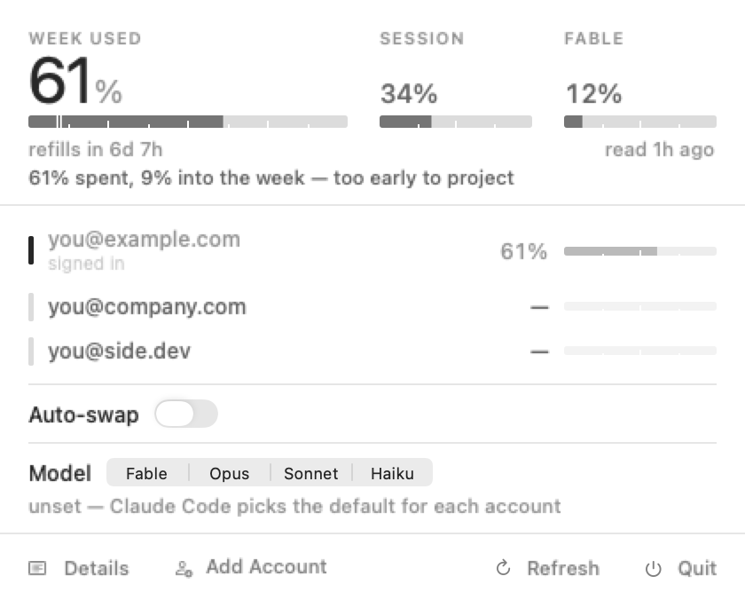
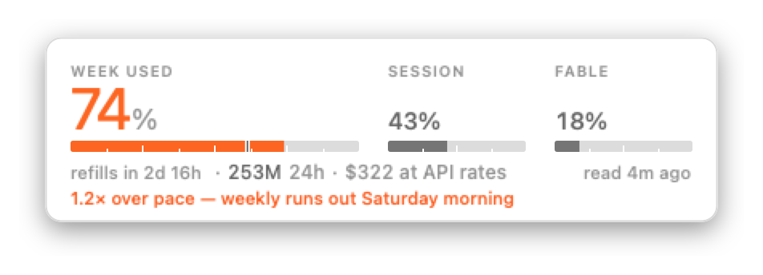
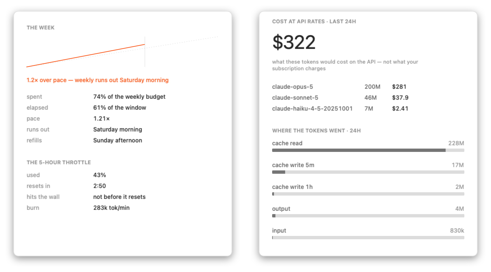
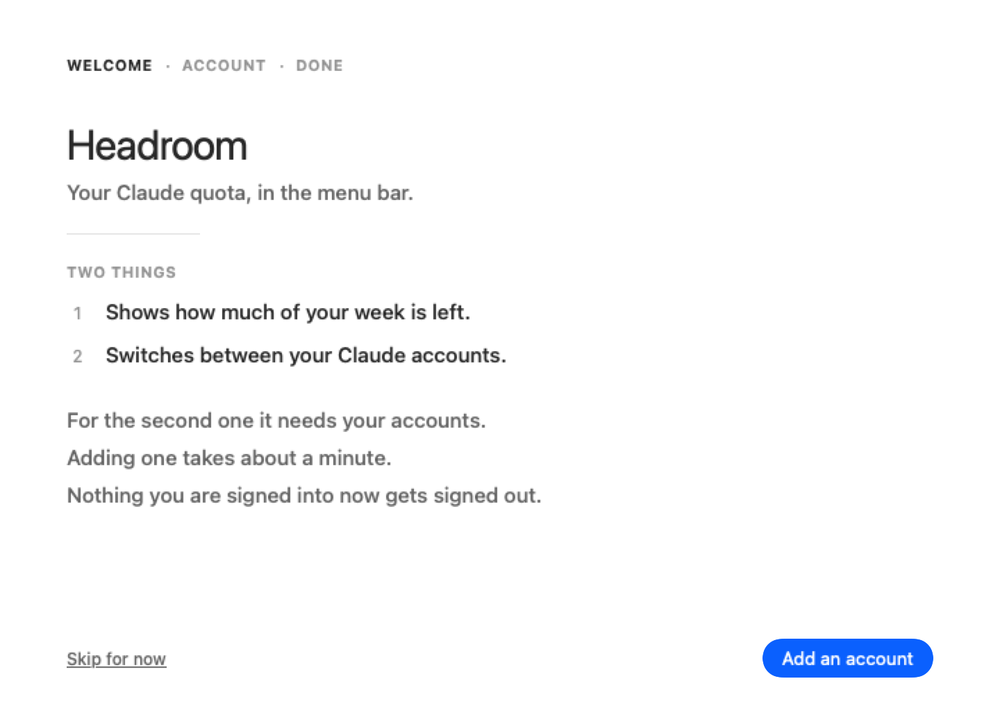

<div align="center">


# 📊 Headroom

**Claude Code quota in your macOS menu bar — and one click to the account that still has room.**

Swift 6 · SwiftUI · AppKit · no dependencies · macOS 14+ (Apple silicon)


</div>

<br>

<div align="center">
<picture>
  <source media="(prefers-color-scheme: dark)" srcset="docs/popover-dark.png">
  
</picture>
</div>

<br>

## What it does

- **Puts the week in the menu bar.** The 7-day window is the budget; the 5-hour one is a throttle. The weekly percentage is the title, and the meter carries a mark showing where spend *should* be by now.
- **Reads every account's quota, not just the one you're signed into.** It asks Anthropic's own usage endpoint with each stored token, so "which account should I move to" is answered with numbers.
- **Swaps accounts in one click** — re-capturing the outgoing account's live credentials first, and refusing while a session is mid-request.
- **Adds accounts without signing you out.** The OAuth exchange runs in-process, so account two never overwrites account one.
- **Prices the day at API rates,** per model, with cache reads and the two cache-write TTLs kept apart.
- **Switches model tier** from the same dropdown, because dropping to Sonnet stretches the week as well.

Two tools sit either side of this one. SessionWatcher reads quota well but cannot switch accounts; [caam](https://github.com/Dicklesworthstone/caam) switches accounts but shows no per-account usage. Headroom does both.

## Install

```sh
git clone https://github.com/hangryclaude/headroom.git
cd headroom && ./install.sh
```

Builds with a Swift 6 toolchain. Xcode is not required — `build.sh` assembles the bundle by hand.

Or take the `.dmg` from [Releases](../../releases) and drag Headroom to Applications.

> [!NOTE]
> The release binary is **Apple silicon only**. On an Intel Mac, build from source — `swift build` produces an x86_64 binary there.

> [!NOTE]
> The build is signed ad-hoc, not notarized. macOS refuses the first launch of a *downloaded* copy. Open **System Settings ▸ Privacy & Security**, find the blocked Headroom entry near the bottom, choose **Open Anyway** — the entry only appears *after* a refused launch. Building from source avoids this entirely.

## The interface

<div align="center">
<picture>
  <source media="(prefers-color-scheme: dark)" srcset="docs/instrument-dark.png">
  
</picture>
</div>

**One number: the week.** It refills weekly and unused capacity is gone forever, so the week leads, the 5-hour window sits beside it, and the menu bar shows the weekly percentage.

**A healthy reading carries no colour at all.** Every other tool in this category ships a green/amber/red status dot, so the interface is shouting even when nothing is wrong and you stop reading it. Here the accent is spent only on the meter actually in trouble. The shot above is at 74% against a 70% threshold, which is why it is barely tinted.

**The weekly meter carries a pace mark** — where spend should be, given how much of the window has elapsed. A percentage alone cannot tell you whether 16% is comfortable or alarming; against the elapsed fraction it can.

## The panel

<div align="center">
<picture>
  <source media="(prefers-color-scheme: dark)" srcset="docs/panel-dark.png">
  
</picture>
</div>

`Details` opens the surface the dropdown deliberately refuses to carry.

| | |
|---|---|
| **The week, plotted** | actual spend against the line it should be following. Over the line is the only thing that takes colour. |
| **Time-to-wall** | measured from transcripts, not inferred from a percentage. |
| **Cost** | priced per model at API rates. Cache reads bill at 0.1× input; cache writes at 1.25× for the 5-minute TTL and **2× for the 1-hour**. |
| **Where the tokens went** | on a real workload cache reads dominate by orders of magnitude, which is the point of showing it. |

That 1.25×/2× split is why the indexer tracks `ephemeral_5m` and `ephemeral_1h` apart. Collapsing them misprices the dominant line item on a cache-heavy workload. A model with no rate on file is named and excluded, never silently folded into the total.

## First run

<div align="center">
<picture>
  <source media="(prefers-color-scheme: dark)" srcset="docs/onboarding-dark.png">
  
</picture>
</div>

The walkthrough fills the screen to introduce itself and to finish, then **shrinks to a corner panel for the one step that needs your browser visible at the same time.** Full screen there would either cover the page holding your code or slip behind Safari with no way back: menu bar apps have no Dock icon and no ⌘-Tab entry.

## Adding an account

Headroom runs the OAuth flow itself, so **adding an account never signs you out of the one you're using.** Click Add Account, sign in, paste the code the page shows you.

That matters more than it sounds. Claude Code's credentials live in a single Keychain item keyed by your *Unix username*, so every Claude account on the machine collides on one slot. Authenticating a second account through `claude /login` therefore overwrites the first — and if your saved copy of the first was stale, its token is stranded. Running the exchange in-process removes that ordering trap: tokens come back to Headroom and go straight into its own store.

The sign-in can also happen on another device:

```sh
Headroom --vault login-url personal      # prints a URL, stashes the verifier
# sign in on your phone, then:
Headroom --vault login-code personal <code>
```

The pasted code is single-use, expires in ~2 minutes, and is worthless without a verifier that never leaves your machine. That is what PKCE is for, and why this step is safe to send over a channel the tokens themselves never should be.

### Where credentials live

You are being asked to hand this thing tokens for paid subscriptions, so:

- Saved accounts sit in `~/Library/Application Support/Headroom/vault/<name>/credentials.json`, one directory per account, mode `0600`. **Plain JSON, not encrypted.** Anything running as you can read them — as is the Keychain item Claude Code already keeps, once you have granted access to it.
- They sit outside the Keychain on purpose. That item is keyed by Unix username, so several Claude accounts cannot coexist in it, and that collision is the bug this app exists to route around.
- The only hosts it contacts are Anthropic's OAuth and usage endpoints. No telemetry, no analytics, no update check.
- `Headroom --vault status` prints what is stored without touching the Keychain, so you can audit it without a prompt.

## Why it swaps the way it does

**Anthropic rotates the refresh token on every redemption, in place.** A stored copy is stale the moment that account is used again, and replaying a consumed refresh token trips reuse detection and revokes the whole token family. That is a dead account, not a logged-out one.

So Headroom **re-captures the outgoing account's live credentials on every swap**, before it writes anything.

It **refuses to swap while a session is mid-request**. `~/.claude/sessions/<pid>.json` lists sessions, but Claude Code does not reliably clean those files up, so each pid is reconciled against the OS with `kill(pid, 0)` plus `proc_pidpath`. The native installer names the binary after the *version* — `.../claude/versions/2.1.223` — so matching on the filename reports every live session as dead.

And it edits `~/.claude.json` **surgically**. Copying the whole file drags `projects`, `mcpServers` and `numStartups` along with the identity, so per-project history follows whichever account you last used. Headroom clears only the account-coupled keys and lets Claude Code refetch them: a cleared cache refetches correctly, a restored stale one stays wrong forever.

## Identity is a UUID, not a fingerprint

Worth its own section, because getting it wrong was the worst bug in this project.

An account is identified by `oauthAccount.accountUuid`. The first version hashed the access and refresh tokens instead, which seemed reasonable. But Claude Code rotates the token in place every few hours, so the hash moves, and the live account stops being recognisable as soon as it's used. Everything downstream then fails in the same direction: the active account looks inactive, so the usage poll reaches for the *stored* copy of its credential and redeems a refresh token the server has already consumed. That revokes the token family. **The account is dead.**

The UUID does not rotate, and it lives in a plain JSON file — so identifying the active account is both correct and free of Keychain prompts.

## Things that will bite anyone touching this

- **Streaming records repeat.** One API request writes several `assistant` lines sharing a `requestId`, and `output_tokens` grows across them while input and cache figures stay fixed. Measured here: **104 records for 41 real requests.** Sum them naively and every token number is ~2.5× too high; take the first and you undercount output. Last-wins on output.
- **`Data.split` is a trap.** Splitting a chunk and materialising each line as its own `Data` turned a 200 MB cold start into *minutes*. Scanning a raw pointer and only materialising matching lines makes it **2.6s**.
- **Blocking main while awaiting a `Task` deadlocks.** This binary links AppKit, which makes the main run loop the default executor, so a synchronous entry point that blocks main hangs forever with the task never scheduled — a stack sample shows one thread in `semaphore_wait_trap`.
- **`URLSession` sends its own User-Agent**, and the token endpoint 429s on some defaults. `TokenRefresher` sets it to the empty string for exactly this reason.
- **A 429 is not a dead account.** `{"error":"invalid_grant"}` means re-login; `{"error":{"type":"rate_limit_error"}}` does not. Confusing them sends you to burn a working login.

## Token refresh

An account's access token expires while it sits unused — so without this, its usage row would eventually read `token expired` for precisely the account you most want to switch to, because you haven't been using it.

`TokenRefresher` is the most dangerous code here, and its ordering is the point:

1. an `O_CREAT | O_EXCL` lock, so only one redemption is ever in flight;
2. the whole credential blob is backed up before the call;
3. the raw server response is **fsync'd to disk before it is parsed**, so a crash during parsing still leaves the rotated pair recoverable by hand;
4. only then is the blob merged and written back — *inside* the lock.

A refresh token absent from the response is preserved, never blanked.

## Commands

```
Headroom --probe                          everything it reads, printed; diff against jq
Headroom --vault status                   stored accounts + identity (never prompts)
Headroom --vault list
Headroom --vault login-url  <name>        start a sign-in, on any device
Headroom --vault login-code <name> <code>
Headroom --vault import     <name> <file> a credential exported from another Mac
Headroom --vault save       <name>        store the current login (prompts once)
Headroom --vault switch     <name>
Headroom --vault usage                    live per-account quota
Headroom --vault login      <name>        sign-in in one terminal: URL, then paste the code
Headroom --vault forget     <name>
Headroom --vault refresh-identity         re-read the identity of the active account
Headroom --vault waste                    what this week's subscription bought, at API rates
Headroom --devin status                   key + org + allowance (never prompts)
Headroom --devin set                      reads the key from stdin, never from argv
Headroom --devin org <org-…>
Headroom --devin allowance <acus>         the denominator the API does not report
Headroom --devin list                     live session list, and the check that it works
Headroom --render <dir>                   every surface to PNG, light and dark
Headroom --icon <dir>                     the app iconset
Headroom --selftest
```

`--vault status` is deliberately prompt-free; `save` is where the Keychain dialog belongs, because a prompt appearing out of nowhere under a dropdown is a bad first experience.

`--devin set` takes the key on stdin (`pbpaste | Headroom --devin set`) rather than as an argument, because argv is readable by every process on the machine and lands in shell history besides. The Devin section only appears once both a key and an org id exist, and the first fetch happens when the dropdown opens — not at launch — for the same prompt-where-expected reason.

Devin publishes no consumption endpoint on a self-serve plan, so ACUs are summed from `acus_consumed` on the session list, which is exact. The plan's *allowance* has no endpoint at all; that is why it is config, and why there is no gauge until you set one.

## Verifying

```sh
Headroom --selftest
```

Covers the paths where being wrong is expensive: pacing that could claim you have room when you do not, the policy that decides when to move accounts, the classification that decides whether you're told to re-login, the refresh lock, and the token merge. The `~/.claude.json` surgery runs against a real copy of the real file rather than a fixture, asserting every unrelated key survives and the original is left byte-identical.

Every screenshot above regenerates from scratch:

```sh
./docs/shoot.sh
```

`HEADROOM_HOME` retargets every path Headroom reads at a throwaway tree, which `docs/fixture.py` writes with invented accounts and an invented week. So the images are the real views with a real `Store` behind them, and no real account address ever ships. The two rows reading `needs login` are the fixture being honest. It carries one working credential, so the other two show a remembered figure as `~24%` instead of letting it pass as live.

## Shape

```
Core/    Quota · UsageClient · AccountVault · TokenRefresher · OAuthFlow · PendingLogin
         SessionGuard · Credentials · Identity · Keychain · Policy · Forecaster · Pricing
         ModelSetting · TranscriptIndexer · Store · LoginItem · ClaudePaths
UI/      AppDelegate · PopoverView · PanelView · Onboarding · Meter
Design/  Theme
```

`Policy` is the switch decision: target is `argmin(0.75·p7 + 0.25·p5)` among accounts with `p5 < 80` and `p7 < 90`. Six verdicts, not a boolean — `STAY` · `SWAP` · `ROTATE-SOON` · `REBALANCE` · `ALL-HOT` · `NO-ACCOUNTS`.

## Not done yet

- **Concurrent multi-account sessions.** Swapping is one account at a time. Running two side by side needs a shallow-HOME approach where only the auth-bearing files are real.
- **A stable signing identity.** Signatures are ad-hoc, so they change every rebuild and the Keychain "always allow" grant does not survive one. A self-signed certificate fixes it.
- **A universal binary.** The release is arm64. Intel Macs have to build from source.
- **Plan-tier weighting.** `Policy` compares raw percentages, so it treats 80% of a Max 5x window as equivalent to 80% of a Max 20x. It is not.

## A note on multiple accounts

Headroom swaps between Claude subscriptions **you own**. Rotating several subscriptions to extend your own limits isn't something Anthropic's usage policy addresses directly, so form your own view before leaning on it. The quota gauge is useful on a single account and Headroom works fine that way.

<div align="center">
<br>
MIT
</div>
